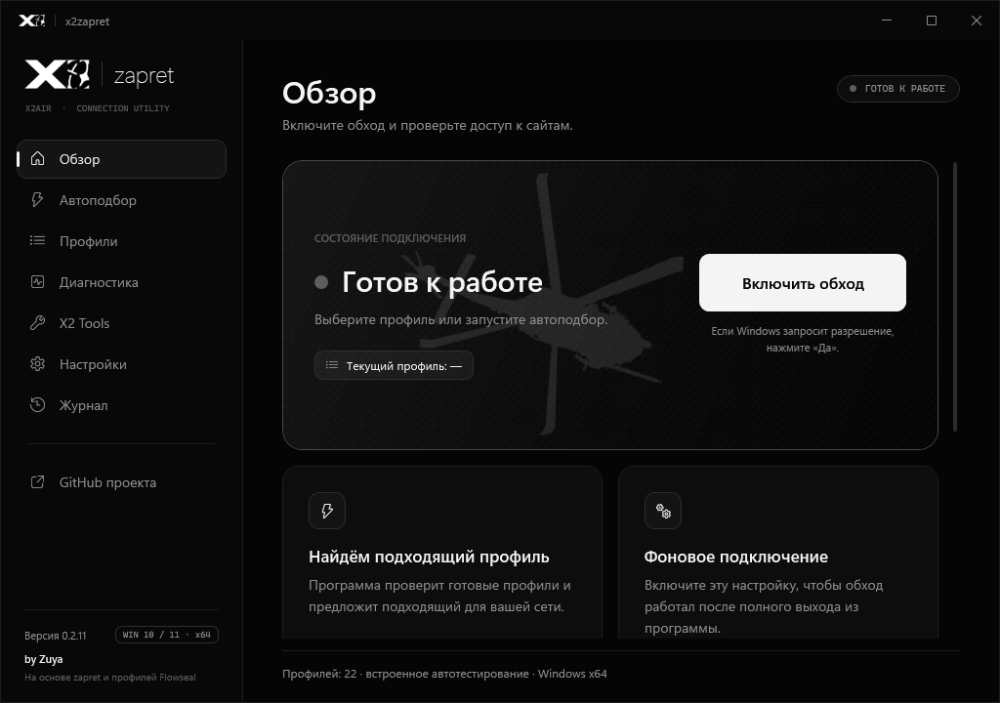
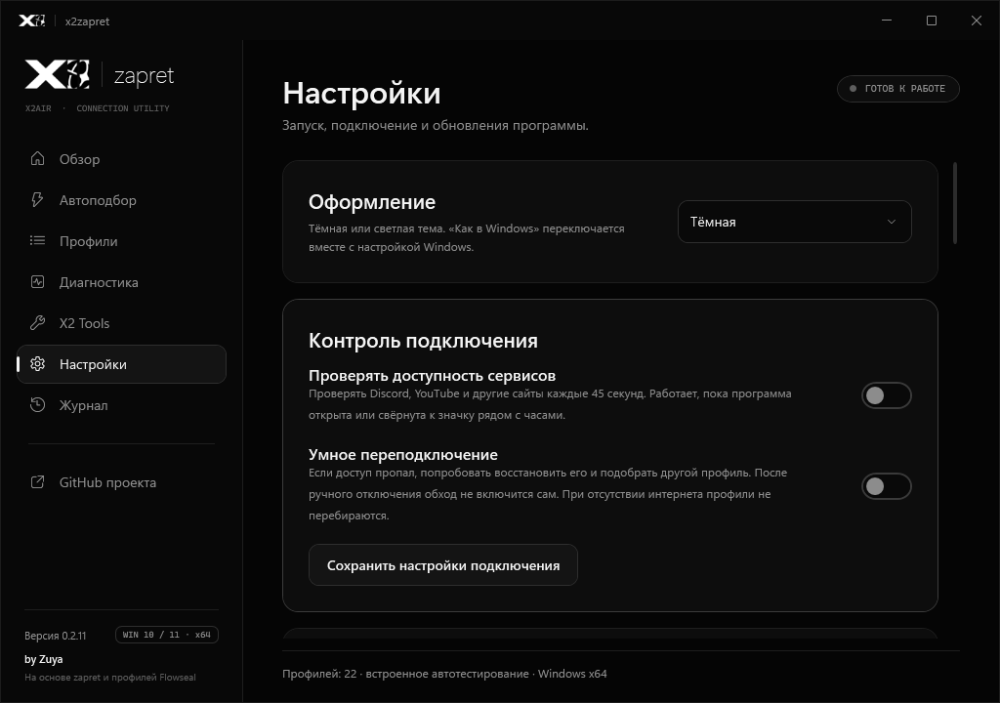

# x2zapret

Приложение для **Windows 10/11 x64** с графическим интерфейсом в стиле **X2AIR**, встроенным автоподбором стратегий и проверкой обновлений.

Основано на движке [zapret](https://github.com/bol-van/zapret) и профилях [Flowseal](https://github.com/Flowseal/zapret-discord-youtube). Все профили текущего закреплённого релиза сохранены. Старые консольные инструменты находятся в `legacy/flowseal` и собираются отдельным архивом. Вкладка **X2 Tools** содержит подробную информацию о ПК и таймер выключения. Обновление компонентов Flowseal описано в [UPSTREAM.md](docs/UPSTREAM.md).

Текущая версия приложения - **0.2.6**.

## Возможности

- Включение и остановка движка одной кнопкой.
- Быстрый, полный и DPI-тесты с повторной проверкой лучших стратегий.
- Отмена тестов с восстановлением прежнего состояния подключения.
- Запуск приложения вместе с Windows в трее и автоматическое подключение последнего профиля.
- Отдельный автозапуск движка через службу Windows.
- Проверка стабильных обновлений при запуске и каждые 6 часов. Скачивание и установка - после подтверждения.
- Настройки фильтрации, пользовательские списки и исключения, диагностика, журнал и экспорт отчётов.
- X2 Tools: 16 разделов информации о ПК, текущая загрузка CPU/RAM и сети, поиск и текстовый отчёт с сокрытием личных данных.
- Таймер выключения с обратным отсчётом и отменой; работает после закрытия приложения.
- Единое чёрно-белое оформление X2AIR, оригинальный логотип и анимированные переключатели.

## Установка и первый запуск

**Готовый файл запуска находится прямо в корне репозитория: `x2zapret.exe`.**
Скачайте репозиторий целиком через **Code → Download ZIP**, распакуйте и запустите этот файл.
В EXE встроены .NET и логотип X2; собирать проект и устанавливать SDK не требуется.
Папки `vendor` и `resources` должны оставаться рядом с EXE: в них находятся движок и списки.
Проверенный корневой EXE обновляется автоматически после изменений приложения в main.

Готовые файлы публикуются в [GitHub Releases](https://github.com/Zuya73/x2zapret/releases). Сборки из основной ветки доступны в [артефактах Windows CI](https://github.com/Zuya73/x2zapret/actions/workflows/desktop.yml) под именем `x2zapret-Windows-x64`; для скачивания артефактов нужен вход в GitHub.

1. Запустите `x2zapret-Setup-0.2.6-x64.exe` либо распакуйте **весь** архив `x2zapret-0.2.6-win-x64.zip`.
2. Откройте `x2zapret.exe` с правами администратора. .NET отдельно устанавливать не нужно.
3. Перейдите в «Автоподбор», запустите проверку и примените подходящую стратегию.
4. В «Настройках» при необходимости включите запуск в трее, автоподключение и проверку обновлений.

Закрытие окна сворачивает приложение в трей, если эта настройка включена. Для полного завершения выберите «Выход» в меню значка.

## Обновления и настройки

Перед запуском установщика проверяются адрес загрузки, размер и SHA256. На время установки приложение и подключение останавливаются; настройки и пользовательские списки сохраняются.

Папка данных остаётся `%ProgramData%\Z-zapret` для совместимости с прежней версией. Репозиторий и приложение называются `x2zapret`.

## Проверки

Windows CI выполняет регрессионные тесты ядра и инструментария, проверки информации о ПК и таймера, сборка приложения и установщика, отрисовка интерфейса, установка в путь с пробелами, обновление с прежним именем EXE, сохранение настроек и автозапуска, скрытый запуск в трее и удаление.

Работа драйвера и обход блокировок зависят от реальной сети и требуют проверки на Windows 10/11. Встроенные HTTPS-тесты не подтверждают воспроизведение видео, QUIC/HTTP3 или голосовой чат.

## Структура и сборка

- `src/` - приложение и ядро.
- `tests/` - регрессионные проверки.
- `resources/` - каталоги профилей и начальные списки.
- `vendor/zapret/` - движок, драйвер, фейки и лицензии.
- `build/` - сборка приложения, установщика и отдельного legacy-архива.
- `legacy/flowseal/` - исходные BAT/PowerShell-инструменты.
- `artifacts/` - результаты сборки, не хранятся в Git.

Откройте `x2zapret.slnx` или выполните `dotnet build x2zapret.slnx -c Release`.
Подробности: [структура проекта](docs/STRUCTURE.md), [сборка](docs/BUILD.md), [старые инструменты](docs/LEGACY.md).

## Документация и исходные проекты

- [Подробное руководство приложения и сборка](docs/USER-GUIDE.md).
- [Исходная документация Flowseal](legacy/flowseal/README.md).
- [Лицензия исходного проекта](LICENSE.txt).
- [Компоненты и сторонние лицензии](docs/THIRD-PARTY-NOTICES.txt).

x2zapret - самостоятельное приложение на основе открытых проектов. Оно не выдаётся за официальный выпуск Flowseal; авторство движка и исходных профилей сохранено.
